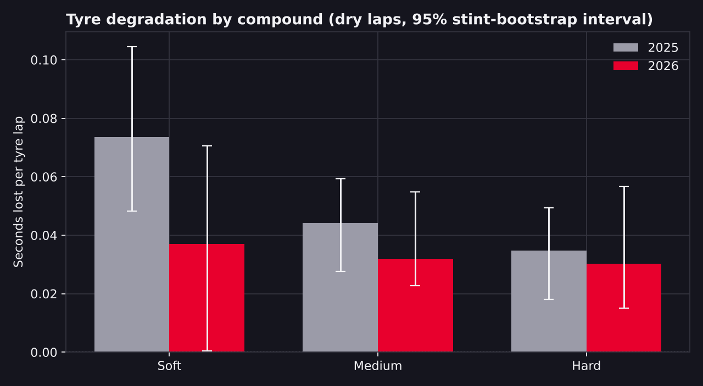
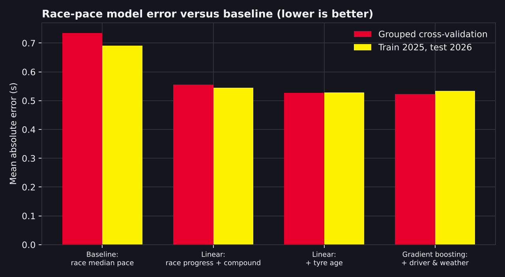

# Pitwall AI

A Ferrari-focused Formula 1 analytics project for Charles Leclerc (`LEC`) and Lewis Hamilton (`HAM`). It downloads
2025 and 2026 race laps with FastF1, estimates **tyre degradation** with honest uncertainty, fits a **race-pace model**
scored against a baseline, simulates **pit strategies**, and answers questions through an **LLM assistant whose
numbers are checked against the data**. Everything is explored in a Streamlit dashboard styled after F1 timing screens.

> Exploratory analysis, not a live strategy system. Lap time also depends on fuel, weather, car updates and
> driver behaviour, so every estimate is shown with its uncertainty.




<!-- ## What it does

| Part | Where | What |
|---|---|---|
| Data | `src/data.py`, `src/cleaning.py` | FastF1 laps and weather; pit, deleted, non-green and lap-1 laps removed; dry-only, sensor-error and slow-lap filters for analysis |
| Degradation | `src/degradation.py` | Huber-robust regression with event-driver fixed effects, 95% intervals from a **bootstrap over whole stints**, per-stint Theil-Sen slopes with a **fuel-burn correction** |
| Pace model | `src/model.py` | Predicts lap time relative to the driver's race median; **cross-validation grouped by race weekend**, baselines, feature ablation, prediction intervals with checked coverage |
| Strategy lab | `src/whatif.py` | 1- and 2-stop simulator with degradation uncertainty; pace what-if with prediction bands |
| Assistant | `src/assistant/` | Tool-calling LLM agent, grounding check on every number, automatic evaluation |
| Tracking | `src/tracking.py` | One JSON line per run (parameters, metrics, git commit) in `experiments/runs.jsonl` |
| Dashboard | `app.py` | Six tabs: race pace, tyre degradation, race table, pace model, strategy lab, Ask Pitwall | -->

## Results snapshot

Adjusted degradation, seconds lost per additional tyre lap (dry laps, 95% stint-bootstrap interval):

| Season | Soft | Medium | Hard |
|---|---|---|---|
| 2025 | 0.074 [0.048, 0.104] | 0.044 [0.028, 0.059] | 0.035 [0.018, 0.049] |
| 2026 | 0.037 [0.000, 0.071] | 0.032 [0.023, 0.055] | 0.030 [0.015, 0.057] |

Race-pace model (mean absolute error in seconds, lower is better), 3,879 dry laps from 44 race weekends:

| Evaluation | Baseline | Selected model | Improvement |
|---|---|---|---|
| Grouped cross-validation (by weekend) | 0.734 | 0.526 | 28% |
| Train 2025, test 2026 | 0.690 | 0.528 | 24% |

Findings worth knowing:

1. **The first model was worse than a naive baseline.** The original Random Forest predicted absolute lap time from the
   circuit name: 3.59 s MAE on 2026 versus 3.20 s for simply using each circuit's 2025 average, and 12.4 s on circuits it
   had never seen. Predicting pace relative to the race median removes the circuit effect.
2. **Classical regression intervals were about three times too narrow** (2025 hard: 0.030 to 0.039) because they treat laps as
   independent. The stint bootstrap gives 0.018 to 0.049.
3. **Raw per-stint slopes understate wear.** The car gets lighter every lap; the regression puts that effect near
   -0.046 s per lap in 2025 and -0.039 s in 2026, which the fuel correction removes.
4. **Feature ablation:** removing race progress (fuel burn) raises error by 0.16 s and removing tyre age by 0.05 s, while
   compound, driver and weather change it by about 0.001 s. Relative pace is explained by fuel and tyre age, not by those.
5. **Prediction intervals are calibrated:** leaving each race weekend out in turn, the 80% and 90% bands (±0.81 s and
   ±1.10 s) contained 80.0% and 90.0% of laps.
6. **Compound pace gaps cannot be estimated from these races.** A diagnostic regression gave medium-versus-hard offsets whose
   intervals included zero, so the strategy simulator takes them as adjustable assumptions instead of pretending to measure them.

## Setup

```bash
python -m venv .venv
source .venv/bin/activate        # Windows: .venv\Scripts\activate
pip install -r requirements-pipeline.txt   # everything; use requirements.txt for the dashboard only
python -m src.data               # download and clean laps (slow on first run, then cached)
python -m src.degradation        # degradation estimates and stint summaries
python -m src.model              # pace model, metrics, intervals and ablation
streamlit run app.py
```

## Assistant ("Ask Pitwall")

The assistant uses an Ollama-compatible chat endpoint that supports tool calling. Create a `.env` file in the project root
with either `PITWALL_LLM_API_KEY` (and optionally `PITWALL_LLM_MODEL`) for a hosted provider, or set
`PITWALL_LLM_BASE_URL` and `PITWALL_LLM_MODEL` for a local Ollama model. Ollama does not need an API key. Keep `.env` private
and do not commit it.

It can only call six analysis tools, and each result carries a `source` it must cite. Two safeguards run on every answer:

- **Grounding check** (`src/assistant/grounding.py`): each number in the answer must equal a tool value rounded to the precision it
  is written with (or a simple difference of two). Anything else is flagged in the UI as not found in the data.
- **Scope rules** in the system prompt: no outside knowledge for figures, and it must say so when the data cannot answer.

Measure it with a fixed question set whose correct answers are computed from your data:

```bash
python -m src.assistant.evaluation            # add --limit 5 for a quick run
```

It scores tool choice, correct values, grounding, source citation and whether the model declines out-of-scope questions
(other drivers, other seasons, predictions, opinions), writes `data/processed/assistant_eval.json`, and the dashboard shows the
summary. No results are published here because they depend on the model you use. The unit tests exercise the plumbing with a
scripted stand-in model, not a real one.

## Strategy lab

Total race time for a plan is the sum of per-stint tyre-age losses plus pit stops and compound pace gaps; fuel burn depends only on
race lap, so it cancels. Degradation and its interval come from the regression. Sampling 1,000 degradation draws gives each plan's
expected time lost versus the best plan and its chance of being best. Stint lengths are capped at the 90th percentile of observed
stints. **Not modelled:** stint order, traffic, safety cars, tyre cliffs, weather. The compound gaps are inputs you set.

<!-- ## Tests and CI

```bash
python -m pytest tests
```

Tests cover cleaning, the regression and its bootstrap coverage, the what-if export versus scikit-learn, strategy rules, the
grounding check, tools and the evaluation harness. GitHub Actions (`.github/workflows/ci.yml`) runs them on every push. -->

<!-- ## Deploy

**Docker**

```bash
docker build -t pitwall-ai .
docker run -p 8501:8501 --env-file .env pitwall-ai
```

For a model on the host machine, set `PITWALL_LLM_BASE_URL=http://host.docker.internal:11434/v1`.

**Streamlit Community Cloud:** point it at `app.py`. It installs `requirements.txt` (no FastF1 or scikit-learn needed). The processed
CSVs and `model_metrics.json` are committed so the app has data. Put the LLM settings in the app's Secrets (top-level keys are also
exposed as environment variables); never commit `.env`. -->

